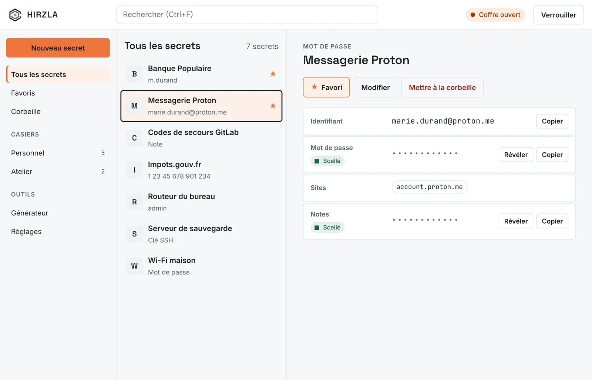

<p align="center">
  
</p>

# Hirzla

**Coffre-fort de mots de passe post-quantique, libre et gratuit, pour Windows, macOS et Linux.**
Seul sur un poste, ou relié à un serveur qui ne peut rien lire.

[Site et documentation](https://phdhebde.github.io/Hirzla/) ·
[Télécharger](https://github.com/Phdhebde/Hirzla/releases) ·
[Installer](https://phdhebde.github.io/Hirzla/installer/) ·
[Questions fréquentes](https://phdhebde.github.io/Hirzla/aide/faq/) ·
[Notes de version](CHANGELOG.md)

[](https://github.com/Phdhebde/Hirzla/actions/workflows/ci.yml)
[](LICENSING.md)



Hirzla garde vos mots de passe, identifiants et notes dans un coffre chiffré sur votre poste.
Il n'y a ni compte, ni abonnement, ni télémétrie : le logiciel fonctionne sans réseau. Une
équipe peut y ajouter un serveur auto-hébergé pour partager des casiers, sans que ce serveur
puisse lire un seul secret.

## En bref

- **Deux modes.** *Self* : un coffre local, sans serveur. *Serveur* : synchronisation,
  casiers partagés, droits par rôle, journal d'audit.
- **Chiffrement de bout en bout.** Tout est chiffré sur le poste. Le serveur range et
  distribue des blocs opaques.
- **Hybride post-quantique.** Chaque échange de clé et chaque signature combine un
  algorithme classique et un algorithme post-quantique normalisé : ECDH P-384 + ML-KEM-1024,
  ECDSA P-384 + ML-DSA-87. Les deux doivent tenir.
- **Rôles portés par des clés.** Avoir un droit, c'est détenir une clé. Le serveur ne peut
  pas s'en accorder.
- **Hors ligne d'abord.** Chaque poste travaille sans réseau et fusionne sans conflit. Aucun
  appel réseau non configuré, mises à jour hors ligne signées.
- **Noyau isolé.** Les clés vivent dans un seul processus. L'application, l'extension et la
  ligne de commande ne reçoivent que le secret demandé.
- **Vérifiable.** Empreintes signées, provenance de compilation, nomenclatures logicielles,
  compilation reproductible sous Linux.
- **Écrit en Rust**, interface Tauri, sans cryptographie maison.

## Ce que contient la version 1

| | |
| --- | --- |
| Application de poste | Windows, macOS, Linux, en français : casiers, recherche, favoris, historique, corbeille, générateur |
| Ligne de commande | `hirzla`, mêmes fonctions que l'application |
| Extension | Firefox et navigateurs Chromium, remplissage à la demande sur le site exact |
| Import | KeePass (KDBX 4) et CSV |
| Recouvrement | Kit à parts : un nombre choisi de parts rouvre le coffre |
| Serveur | `hirzlad` : synchronisation, casiers partagés, rôles, accords à plusieurs, registre de transparence des clés, journal d'audit |

Dans la version 1, le coffre s'ouvre par le **mot de passe maître**. Le déverrouillage par le
matériel (Windows Hello, Touch ID, puce TPM, clé FIDO2) est prévu pour la version 1.1. Les
fichiers publiés et les limites de chaque version sont dans les
[notes de version](CHANGELOG.md).

## Installer

1. Téléchargez l'installeur de votre système sur la page
   [Releases](https://github.com/Phdhebde/Hirzla/releases).
2. Vérifiez-le : empreintes `SHA256SUMS` signées en GPG et provenance de compilation.
3. Installez, puis créez votre coffre.

| Système | Fichier | Guide |
| --- | --- | --- |
| Windows 10 et 11 | `Hirzla_<version>_x64_fr-FR.msi` | [Windows](https://phdhebde.github.io/Hirzla/installer/windows/) |
| macOS 11 et suivants | paquet `.pkg` | [macOS](https://phdhebde.github.io/Hirzla/installer/macos/) |
| Debian, Ubuntu | `Hirzla_<version>_amd64.deb` | [Linux](https://phdhebde.github.io/Hirzla/installer/linux/) |
| Fedora, RHEL, openSUSE | `Hirzla-<version>-1.x86_64.rpm` | [Linux](https://phdhebde.github.io/Hirzla/installer/linux/) |

Le détail, hors ligne compris, est dans le [guide d'installation](docs/installation.md).

## Documentation

Pour les utilisateurs et les administrateurs, le [site](https://phdhebde.github.io/Hirzla/) :
[présentation](https://phdhebde.github.io/Hirzla/decouvrir/),
[installation](https://phdhebde.github.io/Hirzla/installer/),
[utilisation](https://phdhebde.github.io/Hirzla/utiliser/),
[administration du serveur](https://phdhebde.github.io/Hirzla/administrer/).
Ses sources sont dans [`website/`](website/).

Pour les développeurs et les évaluateurs, les spécifications :

| Document | Contenu |
| --- | --- |
| [Installation](docs/installation.md) | Installer et vérifier Hirzla sur Windows, macOS et Linux, extension, mode Serveur |
| [Architecture](docs/architecture.md) | Composants, flux, frontières de confiance |
| [Modèle de menace](docs/modele-de-menace.md) | Actifs, adversaires, hypothèses |
| [Cryptographie](docs/crypto.md) | Suites, hiérarchie de clés, agilité |
| [Rôles](docs/roles.md) | Droits et leur application cryptographique |
| [Format du coffre](docs/format.md) | Spécification du fichier `.hirzla` |
| [Protocole de synchronisation](docs/sync-protocol.md) | Opérations, fusion, échanges |
| [Cible de sécurité](docs/cible-de-securite.md) | Périmètre d'évaluation CSPN |
| [Guide d'administration](docs/evaluation/guide-agd.md) | Configuration évaluée, serveur, exploitation |
| [Feuille de route](docs/feuille-de-route.md) | Phases et critères de sortie |
| [Plan de tests V1](docs/evaluation/plan-de-tests-v1.md) | Essais manuels avant la version 1 |
| [Décisions](docs/adr/) | ADR, une décision par fichier |
| [Notes de version](CHANGELOG.md) | Évolutions de chaque version |
| [Livraison](docs/livraison.md) | Installeurs, signature, flux de publication |
| [Glossaire](docs/glossaire.md) | Vocabulaire fixé |

## Construire depuis les sources

```sh
cargo build --workspace
cargo test --workspace
```

Rust stable, version fixée dans `rust-toolchain.toml` ; CMake (pour AWS-LC), et NASM sous
Windows. Les installeurs se construisent avec la CLI Tauri : voir
[docs/livraison.md](docs/livraison.md) § 2. Une compilation de développement n'exige pas la
signature des clients ; une version de livraison, si (`livraison.md` § 7).

Le site se construit à part : voir [`website/README.md`](website/README.md).

## Contribuer

Les règles sont dans [CONTRIBUTING.md](CONTRIBUTING.md). Un changement du format, du protocole
ou de la suite cryptographique passe d'abord par un ADR.

## Sécurité

Pour signaler une vulnérabilité, voir [SECURITY.md](SECURITY.md). N'ouvrez pas de ticket public.

Hirzla est conçu selon les recommandations de l'ANSSI. Il n'est ni certifié ni qualifié à ce jour.

## Licence

Double licence :

- **GNU AGPL 3.0 ou ultérieure** (`AGPL-3.0-or-later`), pour tous : voir [LICENSE](LICENSE)
  et [NOTICE](NOTICE) ;
- **licence commerciale** accordée par l'auteur, pour qui ne peut pas respecter l'AGPL
  (intégration dans un produit fermé, service en réseau modifié sans publication du code).

Explications et contact : [LICENSING.md](LICENSING.md). Les contributions demandent la
signature de l'accord de contribution ([CLA.md](CLA.md), voir [CONTRIBUTING.md](CONTRIBUTING.md)).
Choix et raisons : ADR 0074, qui remplace l'ADR 0062. Les commits publiés avant ce changement
restent disponibles sous Apache 2.0.
