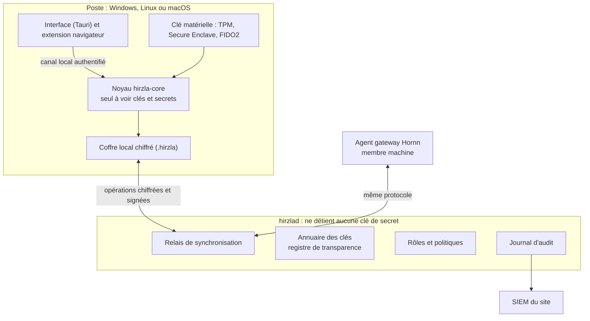

# Architecture

Les clés et les secrets en clair n'existent que dans un processus : le noyau Hirzla, sur le
poste. L'interface lui parle sans voir ses clés. Le serveur ne reçoit que des blocs chiffrés
qu'il range, distribue et journalise.

## Les deux modes

| | Self | Serveur |
| --- | --- | --- |
| Pour qui | Une personne, un poste isolé | Une équipe, une entreprise, un site sensible |
| Secrets | Coffre local `.hirzla` | Coffre local de chaque poste + copie chiffrée sur le serveur |
| Synchronisation | Entre appareils de la personne, par fichier ou réseau local | Par le serveur, avec reprise après déconnexion |
| Partage | Export chiffré pour un destinataire | Casiers partagés, droits par rôle |
| Administration | Aucune | Rôles, politiques, annuaire, audit, rotation |

Un coffre Self se rattache à un serveur en une opération. Le format et le noyau sont identiques.

## Composants

| Composant | Où | Rôle | Voit du clair |
| --- | --- | --- | --- |
| Interface | Poste | Fenêtre, recherche, formulaires | Le secret affiché seulement |
| Extension | Poste | Remplissage dans le navigateur | Le secret rempli, pour le domaine vérifié |
| Noyau `hirzla-core` | Poste | Clés, chiffrement, règles d'accès, fusion | Oui, en mémoire verrouillée |
| Coffre local | Poste | Enregistrements chiffrés, index chiffré | Non |
| Clé matérielle | Poste | Garde la clé qui ouvre le coffre | — |
| Relais | Serveur | Reçoit, ordonne, redistribue les opérations | Non |
| Annuaire des clés | Serveur | Clés publiques, registre de transparence | Non |
| Rôles et politiques | Serveur | Attributions signées, règles | Non |
| Journal d'audit | Serveur | Chaîne signée, export SIEM | Non |
| Membres machines | Réseau | Agent Hornn, agent de rotation | Les secrets de leurs casiers |

## Frontières de confiance

1. **Interface ↔ noyau** : canal local (socket Unix ou tube nommé), authentifié par l'identité
   du processus appelant. L'interface ne reçoit jamais de clé.
2. **Poste ↔ serveur** : TLS 1.3 hybride. Tout contenu est en plus chiffré de bout en bout.
3. **Administration du serveur** : port et interface distincts, certificat client exigé.
4. **Serveur ↔ sceau** : HSM PKCS#11, quorum ou TPM, pour la clé racine du serveur uniquement.

## Les sept choix qui distinguent Hirzla

1. Post-quantique hybride de bout en bout, partage et sauvegardes compris (ADR 0002).
2. Serveur aveugle (ADR 0003).
3. Rôles portés par des clés (ADR 0004).
4. Synchronisation « local d'abord » par journal d'opérations chiffrées (ADR 0005).
5. Déverrouillage lié au matériel (ADR 0006).
6. Noyau isolé dans son processus (ADR 0007).
7. Transparence des clés (ADR 0008), et identifiants leurres qui signalent un vol.

## Flux : lire un secret

1. L'utilisateur déverrouille : la clé matérielle libère la clé du poste.
2. Le noyau ouvre la clé privée de l'utilisateur, puis la clé du casier, puis la clé de donnée.
3. Le noyau déchiffre le secret, le remet à l'interface pour affichage ou à l'extension pour
   remplissage, puis l'efface.
4. En mode Serveur, un événement d'usage signé part vers le journal d'audit.

## Flux : partager un casier

1. Le propriétaire demande la clé publique du destinataire à l'annuaire.
2. Le noyau vérifie sa preuve d'inscription au registre de transparence.
3. Le noyau enveloppe la clé du casier pour cette clé publique et signe l'attribution de rôle.
4. L'attribution est une opération comme une autre : elle se synchronise et s'audite.

## Flux : session Hornn

1. Hornn signe une autorisation de session de 60 secondes.
2. L'agent gateway, membre machine du casier, déchiffre lui-même l'identifiant avec son noyau Hirzla.
3. Il ouvre la connexion, efface le secret, journalise l'usage.
4. À la fermeture, l'agent de rotation change le mot de passe et publie la nouvelle version.

## Haute disponibilité

Trois nœuds `hirzlad` tolèrent une panne, cinq en tolèrent deux. Un nœud seul est supporté.
La panne du serveur n'arrête personne : chaque poste a son coffre complet.
