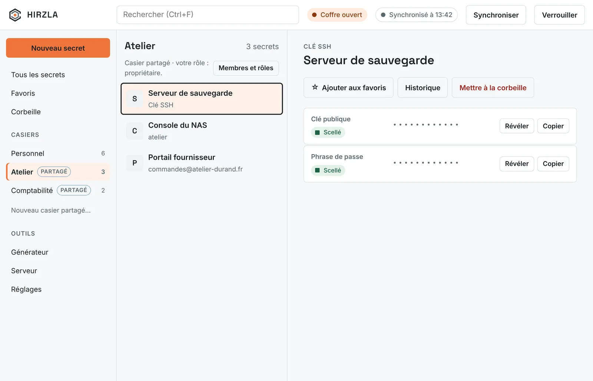
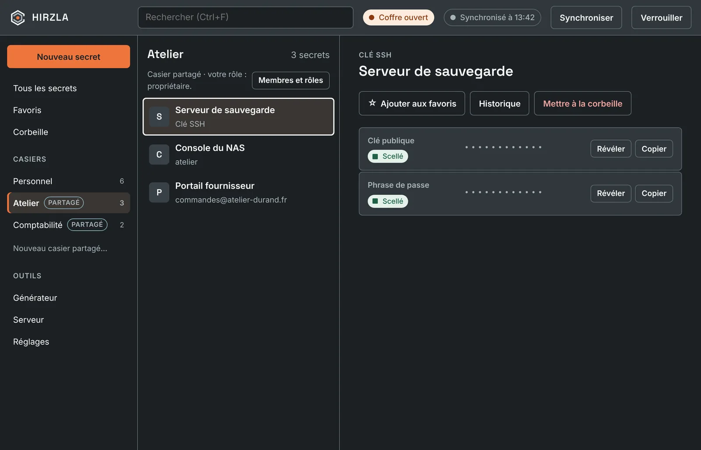

# Mode Self et mode Serveur

Hirzla a deux modes. L'application, le format du coffre et le chiffrement sont les mêmes ; ce
qui change est la présence d'un serveur.

| | Mode Self | Mode Serveur |
| --- | --- | --- |
| Pour qui | Une personne, un poste isolé | Une équipe, une entreprise, un site sensible |
| Où sont les secrets | Dans le coffre local du poste | Dans le coffre local de chaque poste, et en copie chiffrée sur le serveur |
| Serveur | Aucun | `hirzlad`, hébergé par votre organisation |
| Réseau | Aucun | Seulement vers le serveur que vous avez rattaché |
| Partage | Non | Casiers partagés, droits par rôle |
| Administration | Aucune | Comptes, invitations, journal d'audit |

## Mode Self : un coffre pour vous

Vous installez l'application, vous choisissez un mot de passe maître, et votre coffre est un
fichier chiffré sur votre poste. Il n'y a ni compte ni serveur, et Hirzla n'ouvre aucune
connexion. Vous sauvegardez le fichier comme n'importe quel autre.

C'est le mode à choisir pour un usage personnel, ou sur un poste qui ne doit pas communiquer.

[Premiers pas en mode Self](../utiliser/index.md){ .md-button }

## Mode Serveur : partager sans confier ses secrets

Votre organisation héberge un serveur `hirzlad`. Chaque poste garde son coffre complet et
synchronise des **casiers partagés** par le serveur.

{ .capture .clair width="1600" height="1030" loading="lazy" }
{ .capture .sombre width="1600" height="1030" loading="lazy" }

- **Le serveur est aveugle.** Il reçoit des blocs chiffrés et signés, les range et les
  redistribue. Il ne détient aucune clé capable de desceller un secret.
- **Les droits sont des clés.** Donner accès à un casier, c'est chiffrer la clé du casier
  pour la personne. Le serveur ne peut pas le faire à sa place.
- **Hors ligne d'abord.** Vous lisez et modifiez vos secrets sans réseau. Les modifications
  se fusionnent à la reconnexion, sans conflit à résoudre à la main.
- **Tout est tracé.** Le serveur tient un journal d'audit chaîné et signé, exportable vers
  l'outil de supervision du site. Le journal ne contient aucune valeur de secret.

### Les rôles d'un casier

| Rôle | Lire | Écrire | Partager | Gérer les rôles |
| --- | --- | --- | --- | --- |
| Propriétaire | Oui | Oui | Oui | Oui |
| Gestionnaire | Oui | Oui | Oui | Non |
| Éditeur | Oui | Oui | Non | Non |
| Lecteur | Oui | Non | Non | Non |
| Auditeur | Non | Non | Non | Non (voit le journal, sans valeur) |

L'administrateur du serveur gère les comptes. Il n'a accès à aucun casier.

## Passer de l'un à l'autre

Un coffre Self se rattache à un serveur en une opération : vos secrets personnels restent dans
votre casier personnel, et les casiers partagés s'ajoutent. Voir
[Rejoindre un serveur](../utiliser/rejoindre-un-serveur.md).

## Lequel choisir ?

- Vous êtes seul, ou votre poste est isolé : **mode Self**.
- Vous devez partager des identifiants à plusieurs, savoir qui a accès à quoi et garder une
  trace : **mode Serveur**.
