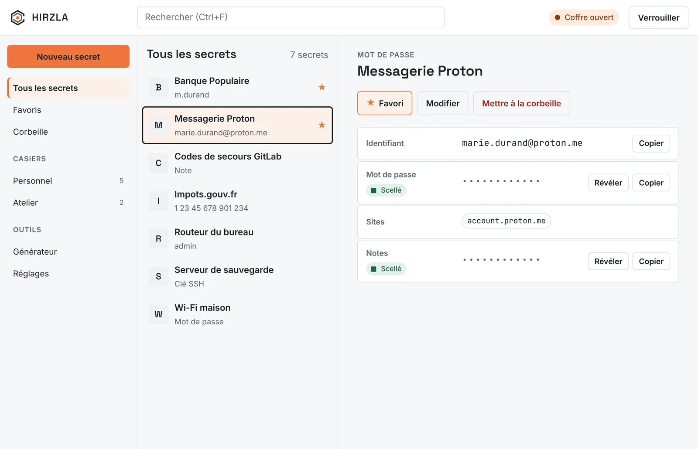
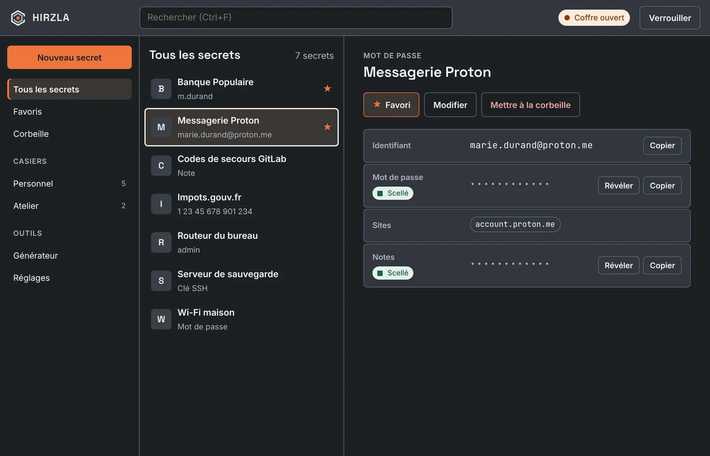

# Le coffre-fort de mots de passe post-quantique, libre et gratuit

Hirzla garde vos mots de passe, identifiants et notes dans un coffre chiffré
sur votre poste. Il fonctionne seul, sans compte ni réseau, ou relié à un serveur de votre
organisation qui ne peut rien lire. Pour Windows, macOS et Linux.

[Installer Hirzla](installer/index.md){ .md-button .md-button--primary }
[Découvrir le fonctionnement](decouvrir/index.md){ .md-button }

{ .capture .clair width="1600" height="1030" }
{ .capture .sombre width="1600" height="1030" }

## Hirzla en bref

Hirzla est un gestionnaire de mots de passe **gratuit et open source** (licence Apache 2.0),
écrit en Rust. Il s'adresse aux particuliers, aux équipes et aux organisations qui veulent
garder la main sur leurs secrets, y compris dans un environnement sensible ou sans accès à
Internet.

### Chiffré sur votre poste
Tout est chiffré et déchiffré sur votre ordinateur. Vos clés ne le quittent jamais.

### Post-quantique hybride
Chaque échange de clé et chaque signature combine un algorithme classique et un algorithme
post-quantique normalisé par le NIST (ML-KEM, ML-DSA).

### Deux modes
*Self* : un coffre local, sans serveur. *Serveur* : casiers partagés, rôles, synchronisation
et journal d'audit pour une équipe.

### Un serveur qui ne lit rien
Le serveur `hirzlad` s'héberge chez vous. Il range et distribue des blocs chiffrés, sans
jamais détenir une clé capable de les ouvrir.

### Hors ligne d'abord
Aucune télémétrie, aucun appel réseau non configuré. Hirzla s'installe, s'utilise et se met à
jour sur un poste débranché.

### Libre et vérifiable
Code public, spécifications publiées, installeurs à empreintes signées et provenance de
compilation vérifiable.

## Pour qui ?

| Vous êtes | Hirzla vous apporte | Par où commencer |
| --- | --- | --- |
| Une personne seule | Un coffre local, sans compte, sans abonnement, importable depuis KeePass | [Installer](installer/index.md), puis [premiers pas](utiliser/index.md) |
| Une équipe | Des casiers partagés avec des droits par rôle, utilisables hors ligne | [Mode Self et mode Serveur](decouvrir/modes.md) |
| Un administrateur | Un serveur auto-hébergé, sans dépendance externe, avec journal d'audit exportable | [Installer le serveur](administrer/index.md) |
| Un site sensible ou isolé | Un produit qui fonctionne sans Internet, avec des mises à jour hors ligne signées | [Comment Hirzla protège vos secrets](decouvrir/fonctionnement.md) |

## Ce que contient la version 1

- Application de poste en français pour Windows, macOS et Linux, ligne de commande `hirzla`,
  extension pour Firefox et les navigateurs Chromium.
- Coffre local : casiers, favoris, recherche, historique des versions, corbeille, générateur
  de mots de passe, verrouillage automatique.
- Import depuis KeePass (KDBX 4) et depuis un fichier CSV.
- Kit de recouvrement : des parts confiées à des personnes de confiance rouvrent le coffre si
  le mot de passe maître est perdu.
- Mode Serveur : synchronisation, casiers partagés, rôles, accords à plusieurs, registre de
  transparence des clés, journal d'audit.

!!! note "Déverrouillage"
    Dans la version 1, le coffre s'ouvre par le **mot de passe maître**. Le déverrouillage par
    le matériel (Windows Hello, Touch ID, puce TPM, clé FIDO2) est prévu pour la version 1.1.

## Transparence

Hirzla est conçu selon les recommandations de l'ANSSI. Il n'est **ni certifié ni qualifié** à
ce jour. Le code, les spécifications du format et du protocole, et le modèle de menace sont
publics dans le [dépôt GitHub](https://github.com/Phdhebde/Hirzla) : chacun peut les relire.
Voir [Sécurité et projet](aide/projet.md).
