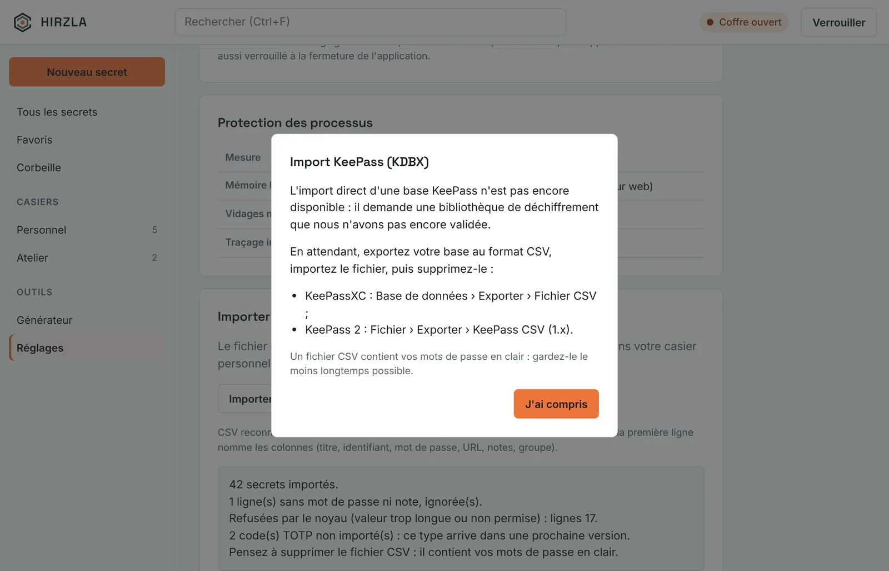
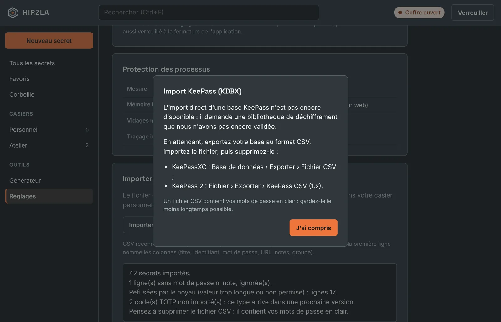

# Importer depuis KeePass ou un fichier CSV

L'import se fait dans **Réglages › Importer**. Chaque entrée est créée dans votre casier
personnel. Rien n'est envoyé hors de votre poste.

{ .capture .clair width="1600" height="1030" loading="lazy" }
{ .capture .sombre width="1600" height="1030" loading="lazy" }

## Depuis KeePass ou KeePassXC (KDBX)

C'est la voie à préférer : la base reste chiffrée jusqu'au noyau, qui la lit et la déchiffre
lui-même.

1. Cliquez sur **Importer depuis KeePass (KDBX)…**
2. **Choisir la base…**, puis saisissez le mot de passe de la base KeePass. Si la base est
   protégée par un **fichier clé**, choisissez-le avec **Fichier clé…** ; laissez le mot de
   passe vide si la base n'en a pas.
3. Cliquez sur **Importer**. Un compte rendu indique ce qui a été créé.

| | |
| --- | --- |
| Bases acceptées | KDBX 3.1 et 4 (KeePass 2, KeePassXC), protégées par un mot de passe, un fichier clé ou les deux, chiffrées en AES-256 ou ChaCha20, dérivation AES-KDF ou Argon2 |
| Repris | Titre, identifiant (même sans mot de passe), mot de passe, adresse, notes, étiquettes, champs personnalisés, pièces jointes, références entre entrées (`{REF:…@I:…}`), TOTP (KeePassXC `otp`, KeePass 2 `TimeOtp-*` en base32, hexadécimal, base64 ou texte, KeeTrayTOTP). Le groupe devient une étiquette `Groupe/Sous-groupe` |
| Gardés dans des champs | Expiration, saisie automatique, HOTP, TOTP non convertibles (Steam, hors limites) |
| Non importés | Historique des entrées, corbeille KeePass, Twofish. Le compte rendu les signale |

En ligne de commande :

```sh
hirzla import-kdbx ancienne-base.kdbx
hirzla import-kdbx ancienne-base.kdbx --fichier-cle ancienne-base.keyx
```

## Depuis un fichier CSV

1. Exportez vos mots de passe en CSV depuis votre gestionnaire actuel.
2. Cliquez sur **Importer un fichier CSV…** et choisissez le fichier.

CSV reconnus : KeePass, KeePassXC, Bitwarden, Firefox, Chrome, et les tableurs dont la première
ligne nomme les colonnes (titre, identifiant, mot de passe, URL, notes, groupe).

!!! warning "Supprimez le fichier CSV aussitôt"
    Un export CSV contient tous vos mots de passe **en clair**. Supprimez-le dès que l'import
    est terminé, et videz la corbeille du système.

## Après l'import

- Vérifiez quelques entrées, puis créez un [kit de recouvrement](recouvrement.md).
- Gardez votre ancienne base quelques jours, le temps de valider la migration, puis
  supprimez-la.
