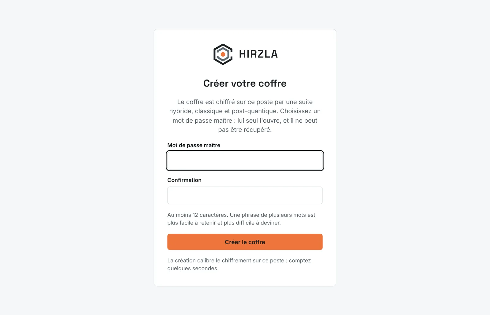
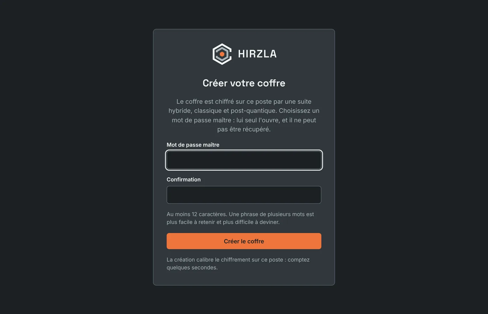
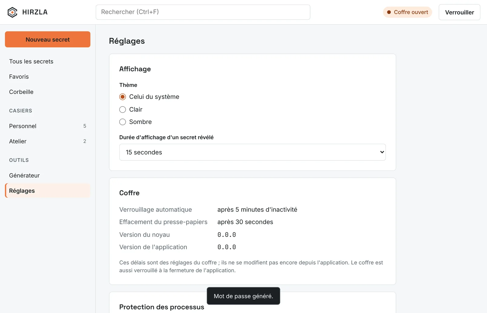
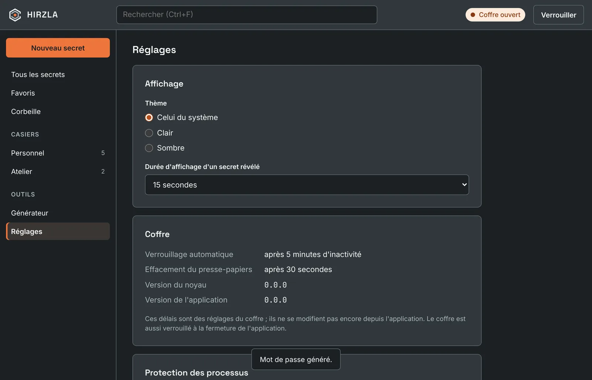

# Premiers pas

Hirzla est [installé](../installer/index.md). Cette page vous mène à un coffre prêt à servir,
en mode Self : un coffre local, sans serveur. Tout ce qui suit fonctionne hors ligne.

## 1. Créer votre coffre

1. Lancez **Hirzla**. L'écran « Créer votre coffre » s'affiche.
2. Choisissez un **mot de passe maître** d'au moins 12 caractères. Tapez-le dans « Mot de
   passe maître » puis « Confirmation », et cliquez sur **Créer le coffre**.
3. La création calibre le chiffrement sur votre poste : comptez quelques secondes.

{ .capture .clair width="1600" height="1030" loading="lazy" }
{ .capture .sombre width="1600" height="1030" loading="lazy" }

!!! warning "Le mot de passe maître ne peut pas être récupéré"
    Il n'est stocké nulle part et personne ne peut le réinitialiser. Choisissez-le long et
    unique, par exemple une phrase de plusieurs mots, et créez un kit de recouvrement
    (étape 3).

## 2. Régler le verrouillage

Dans **Réglages › Coffre** :

- le **verrouillage automatique** après un délai d'inactivité ;
- l'**effacement du presse-papiers** après une copie ;
- le verrouillage « à la mise en veille du poste » et « au verrouillage de votre session » :
  gardez-les cochés.

Cliquez sur **Enregistrer les réglages**. Le bouton **Verrouiller**, en haut de la fenêtre,
verrouille le coffre à tout moment. Fermer l'application le verrouille aussi.

{ .capture .clair width="1600" height="1030" loading="lazy" }
{ .capture .sombre width="1600" height="1030" loading="lazy" }

## 3. Créer un kit de recouvrement

Le kit partage une clé de secours en plusieurs parts. Un nombre choisi de parts rouvre le
coffre sans le mot de passe maître. Voir [Sauvegarde et recouvrement](recouvrement.md).

## 4. Ajouter vos secrets

- Vous venez d'un autre gestionnaire : [importez](importer.md) votre base KeePass ou un
  fichier CSV.
- Sinon, cliquez sur **Nouveau secret** : voir [Gérer vos secrets](secrets.md).

## Où est le coffre ?

Le coffre est un fichier :

| Système | Emplacement |
| --- | --- |
| Windows | `%APPDATA%\Hirzla\coffre.hirzla` |
| macOS | `~/Library/Application Support/Hirzla/coffre.hirzla` |
| Linux | `~/.local/share/hirzla/coffre.hirzla` (ou `$XDG_DATA_HOME/hirzla/`) |

Sauvegardez-le comme tout fichier. Il est chiffré, et inutilisable sans le mot de passe maître
ou le kit de recouvrement.

## Ensuite

- [Installer l'extension de navigateur](../installer/extension.md)
- [Rejoindre le serveur de votre organisation](rejoindre-un-serveur.md)
- [Utiliser la ligne de commande](ligne-de-commande.md)
