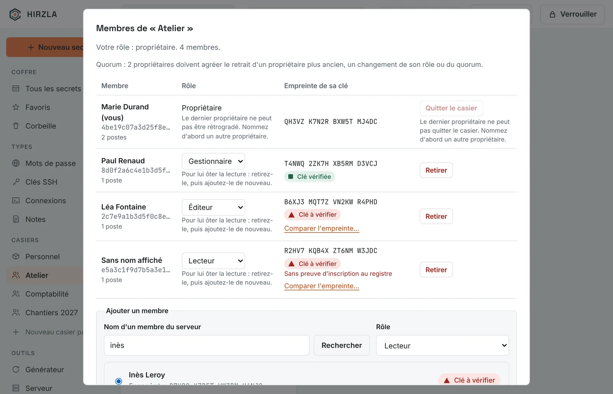
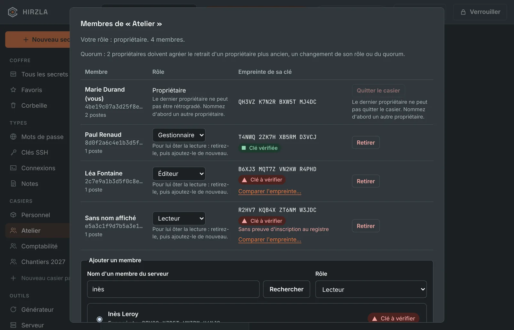

# Partager un casier

Le partage demande le mode Serveur : votre coffre doit être
[rattaché à un serveur](rejoindre-un-serveur.md). Sans serveur, vous pouvez
[remettre une copie chiffrée d'un casier](exporter-un-casier.md) à un collègue.

On ne partage pas un secret isolé, mais un **casier** : un groupe de secrets qui ont les mêmes
membres. Pour partager un seul secret, placez-le dans un casier dédié.

## Créer un casier partagé

Dans la liste des casiers, cliquez sur **Nouveau casier partagé** et nommez-le. Vous en êtes le
propriétaire. À la création d'un secret, choisissez ce casier dans le champ « Casier ».

## Ajouter un membre

1. Dans **Serveur**, « Votre identité », chaque membre inscrit son **nom affiché** : c'est grâce à
   lui que les autres le trouvent.
2. Ouvrez les **membres** du casier. Dans « Ajouter un membre », recherchez la personne par son
   nom, choisissez-la dans les résultats et choisissez son **rôle**.
3. La première fois, Hirzla vous fait **comparer l'empreinte** de sa clé : appelez la personne
   et demandez-lui de lire celle qu'affiche son poste. Un nom se choisit librement, seule
   l'empreinte prouve à qui appartient la clé. Les membres déjà comparés portent la mention
   « Clé vérifiée ».
4. Validez. Votre poste chiffre la clé du casier pour les appareils de ce membre. Le casier
   apparaît chez lui à sa prochaine synchronisation.

L'ajout par identifiant de membre reste possible, sous « Ajouter par identifiant de membre ».

{ .capture .clair width="1600" height="1030" loading="lazy" }
{ .capture .sombre width="1600" height="1030" loading="lazy" }

## Les rôles

| Rôle | Lire | Écrire | Partager | Gérer les rôles |
| --- | --- | --- | --- | --- |
| Propriétaire | Oui | Oui | Oui | Oui |
| Gestionnaire | Oui | Oui | Oui | Non |
| Éditeur | Oui | Oui | Non | Non |
| Lecteur | Oui | Non | Non | Non |
| Auditeur | Non | Non | Non | Non (voit le journal du casier, sans valeur) |

- **Partager** : attribuer les rôles éditeur, lecteur ou auditeur. Seul un propriétaire nomme
  un propriétaire ou un gestionnaire.
- Tout membre peut quitter un casier, sauf le dernier propriétaire.

## Retirer un membre

Cliquez sur **Retirer** en face du membre. La clé du casier est renouvelée et les secrets sont
rescellés sous la nouvelle clé.

!!! warning "Qui a pu lire a pu copier"
    Après un retrait, changez sur les services concernés les mots de passe que la personne a pu
    lire. C'est la seule protection réelle.

## Décisions à plusieurs propriétaires

Un propriétaire retire seul un propriétaire nommé après lui. Retirer ou rétrograder un
propriétaire **plus ancien**, ou changer le quorum, demande l'**accord** de plusieurs
propriétaires : 2 par défaut, réglable par casier.

1. Le demandeur prépare la demande depuis les membres du casier. Elle part scellée par le
   serveur, qui ne peut ni la lire ni la signer.
2. Chaque propriétaire la trouve dans **Serveur**, « Demandes à examiner ». Avant de signer, il
   vérifie de vive voix auprès du demandeur que la demande vient bien de lui. Il peut aussi
   la refuser.
3. Les accords reviennent au demandeur à la synchronisation. Quand le quorum est atteint, il
   applique la décision depuis « Vos demandes ».

Sans serveur joignable, la demande et l'accord s'échangent aussi par copie.

## Quarantaine

Une modification écrite par un membre ou un appareil déjà retiré peut être légitime (écrite
hors ligne avant le retrait) ou non. Hirzla la place en **quarantaine** : elle n'est ni
appliquée ni diffusée. Un propriétaire l'accepte ou la rejette. Sans décision dans le délai du
casier, 7 jours par défaut, elle est rejetée.

## En ligne de commande

```sh
hirzla casier creer Atelier
hirzla casier membres Atelier
hirzla casier ajouter Atelier MEMBRE lecteur --empreinte "XXXXX XXXXX XXXXX XXXXX"
hirzla casier retirer Atelier MEMBRE
hirzla set "Routeur du bureau" --casier Atelier --generer
```

Rôles : `proprietaire`, `gestionnaire`, `editeur`, `lecteur`, `auditeur`. Les accords et
la quarantaine se pilotent par `hirzla accord` et `hirzla quarantaine` : voir
[Ligne de commande](ligne-de-commande.md).
