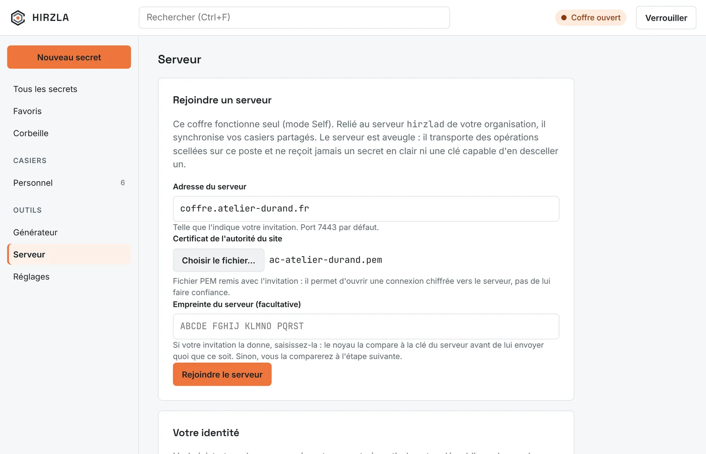
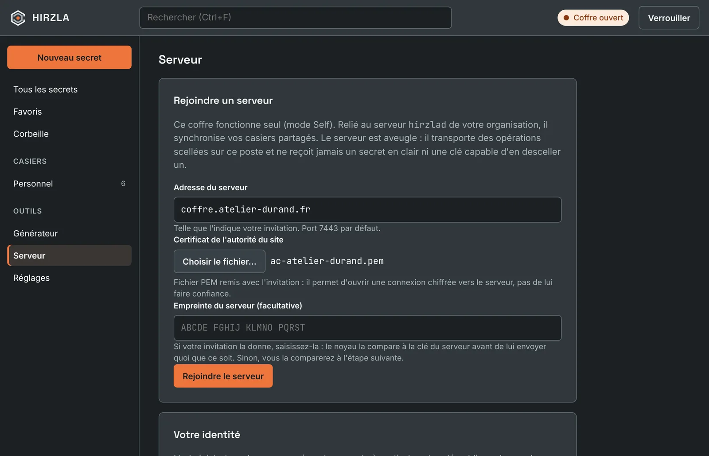

# Rejoindre un serveur

En mode Serveur, votre coffre synchronise des casiers partagés avec le serveur `hirzlad` de
votre organisation. Le serveur est aveugle : il ne reçoit jamais un secret en clair ni une clé
capable d'en desceller un. Votre coffre local reste utilisable hors ligne.

Il vous faut un coffre déjà créé ([premiers pas](index.md)) et un administrateur du serveur.

## 1. Transmettre votre identité

1. Dans **Serveur › Votre identité**, cliquez sur **Enregistrer votre clé publique…** et
   remettez le fichier à l'administrateur.
2. Lisez-lui ensuite l'**empreinte de votre clé** par un autre canal, de vive voix ou par
   téléphone. Il la compare avant de créer votre compte.

!!! info "Pourquoi un autre canal ?"
    L'empreinte prouve que la clé reçue par l'administrateur est bien la vôtre. Si elle
    voyageait avec le fichier, quelqu'un qui remplacerait le fichier remplacerait aussi
    l'empreinte.

## 2. Recevoir l'invitation

L'administrateur vous remet un **lien d'invitation** : un texte qui commence par
`hirzla-invitation:` et contient l'adresse du serveur, le certificat de l'autorité du site et
l'empreinte du serveur.

## 3. Rejoindre

Dans **Serveur › Rejoindre un serveur**, collez le lien dans « Lien d'invitation » et cliquez
sur **Rejoindre avec le lien**. Le noyau compare l'empreinte à la clé du serveur avant de lui
envoyer quoi que ce soit. Un lien altéré est refusé.

{ .capture .clair width="1600" height="1030" loading="lazy" }
{ .capture .sombre width="1600" height="1030" loading="lazy" }

??? note "Sans lien d'invitation"
    Saisissez les trois éléments : l'adresse (`hirzla://hôte[:port]`, port 7443 par défaut),
    le fichier PEM de l'autorité et l'empreinte du serveur. Si vous laissez l'empreinte vide,
    l'écran « Confirmer l'empreinte du serveur » vous demande de la recopier après l'avoir
    comparée, caractère par caractère, avec celle de l'administrateur reçue par un autre canal.
    Si elles diffèrent, ne confirmez pas et prévenez l'administrateur.

## 4. Synchroniser

Cliquez sur **Synchroniser**, ou choisissez une « Synchronisation automatique ». Les casiers
qu'un propriétaire vous a ouverts apparaissent dans « Casiers partagés ».

Si le serveur est injoignable, vous continuez à travailler : les modifications partent à la
prochaine synchronisation.

## En ligne de commande

```sh
hirzla serveur identite --sortie membre.pub     # à remettre à l'administrateur
hirzla serveur rejoindre 'hirzla-invitation:…'  # ou @fichier
hirzla serveur sync
hirzla serveur etat
```

## Les alertes du registre de transparence

La carte **Registre de transparence des clés** signale ce qui doit vous alerter.

| Alerte | Que faire |
| --- | --- |
| Un appareil inconnu est inscrit à votre nom | Cliquez sur **Révoquer cet appareil**, depuis votre appareil de certification, et prévenez l'administrateur |
| Le registre est incohérent (« registre suspect ») | Le partage s'arrête. Prévenez votre administrateur de sécurité : c'est une preuve à lui transmettre |
