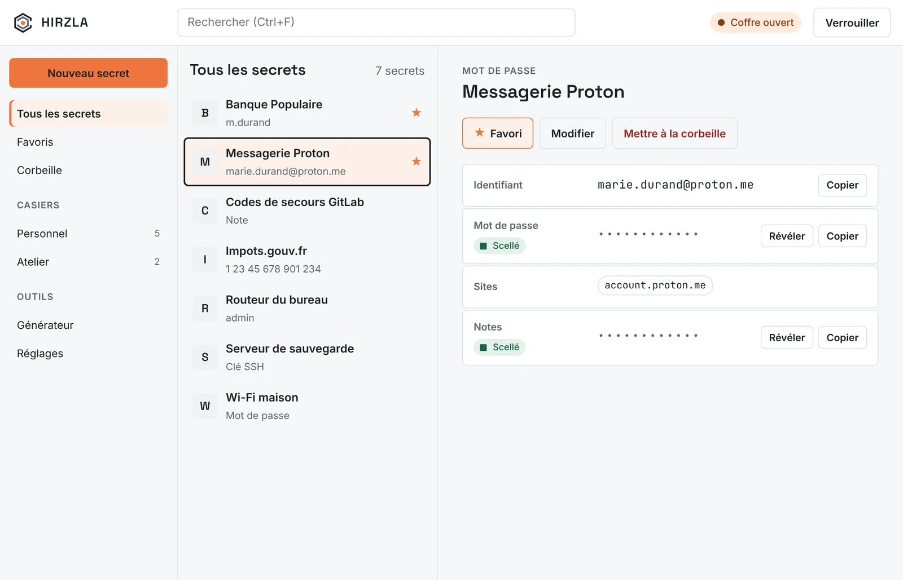
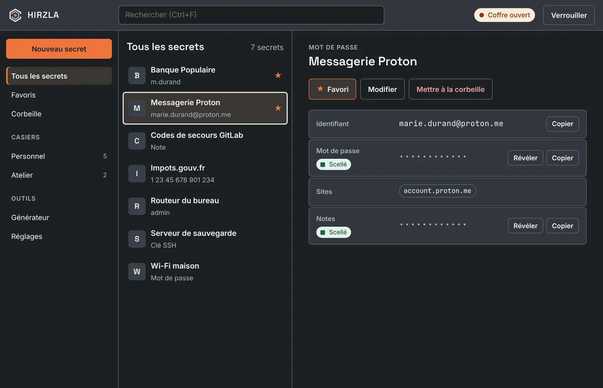

# Gérer vos secrets

{ .capture .clair width="1600" height="1030" loading="lazy" }
{ .capture .sombre width="1600" height="1030" loading="lazy" }

## Le vocabulaire

| Terme | Sens |
| --- | --- |
| Coffre | L'ensemble de vos casiers. Il est **verrouillé** ou **ouvert** |
| Casier | Un groupe de secrets qui partagent une clé et des droits |
| Secret | Une entrée : un mot de passe ou une note. Il est **scellé** (chiffré) ou **descellé** (révélé) |

## Créer un secret

1. Cliquez sur **Nouveau secret**.
2. Choisissez le type : **Mot de passe** ou **Note**.
3. Renseignez le titre, l'identifiant et le mot de passe, ou cliquez sur **Générer**.
4. Dans « Adresses web », indiquez l'adresse du site, une par ligne. L'extension ne remplira
   l'identifiant que sur ces sites.
5. Ajoutez si besoin des étiquettes et des notes, cochez **Favori**, puis **Enregistrer**.

## Générer un mot de passe

L'outil **Générateur** produit des mots de passe aléatoires, tirés par le noyau. Vous réglez
la longueur et les familles de caractères.

{ .capture .clair width="1600" height="1030" loading="lazy" }
{ .capture .sombre width="1600" height="1030" loading="lazy" }

## Lire et copier

Sur la fiche d'un secret, la valeur reste scellée tant que vous ne la demandez pas.

- **Copier** place la valeur dans le presse-papiers, qui est effacé après le délai réglé.
- **Révéler** affiche la valeur à l'écran.

## Retrouver un secret

- Le champ **Filtrer la liste** (++ctrl+f++) filtre la liste.
- La palette (++ctrl+k++) mène à un secret ou à une action depuis le clavier ; ++ctrl+enter++ y copie le mot de passe.
- **Favoris** regroupe les secrets marqués d'une étoile.
- Les casiers, à gauche, filtrent par casier.

## Modifier, historique et corbeille

- **Modifier** enregistre une nouvelle version du secret. L'**historique** garde les versions
  précédentes et permet d'en restaurer une.
- **Mettre à la corbeille** retire le secret de la liste. Vous pouvez le restaurer depuis la
  **Corbeille**.

## Changer le mot de passe maître

Dans **Réglages › Mot de passe maître**, saisissez le mot de passe actuel puis le nouveau
(12 caractères au moins), et cliquez sur **Changer le mot de passe**. L'ancien mot de passe
n'ouvre plus le coffre.

## Remplir dans le navigateur

Avec l'[extension](../installer/extension.md), ouvrez le coffre, allez sur le site, puis
cliquez sur l'icône Hirzla ou tapez ++alt+shift+h++. L'identifiant n'est rempli que si l'adresse
du site est exactement celle enregistrée avec le secret, en `https`.
