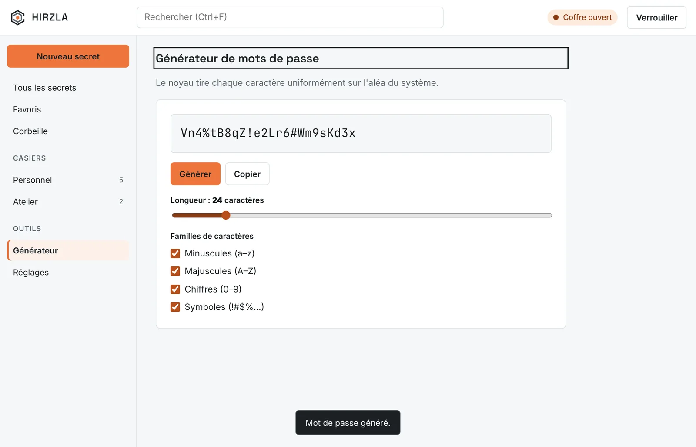
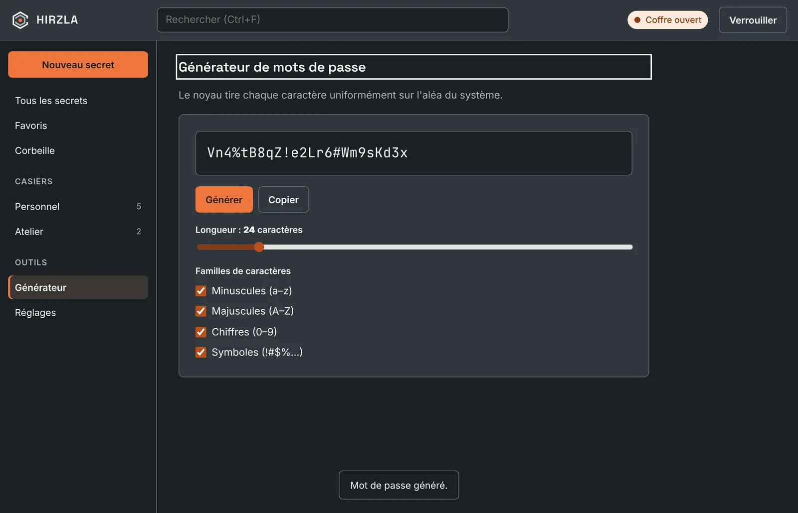

# Gérer vos secrets

{ .capture .clair width="1600" height="1030" loading="lazy" }
{ .capture .sombre width="1600" height="1030" loading="lazy" }

## Le vocabulaire

| Terme | Sens |
| --- | --- |
| Coffre | L'ensemble de vos casiers. Il est **verrouillé** ou **ouvert** |
| Casier | Un groupe de secrets qui partagent une clé et des droits |
| Secret | Une entrée : un mot de passe ou une note. Il est **scellé** (chiffré) ou **descellé** (révélé) |

## Créer un secret

1. Cliquez sur **Nouveau secret**.
2. Choisissez le type : **Mot de passe**, **Note**, **Connexion SSH**, **Connexion RDP**,
   **Clé SSH** ou **Code TOTP**.
3. Renseignez le titre, l'identifiant et le mot de passe, ou cliquez sur **Générer**.
4. Dans « Adresses web », indiquez l'adresse du site, une par ligne. L'extension ne remplira
   l'identifiant que sur ces sites.
5. Ajoutez si besoin des étiquettes et des notes, cochez **Favori**, puis **Enregistrer**.

## Connexions SSH et RDP

Une connexion range ce qu'il faut pour joindre une machine : hôte, port, identifiant, mot de
passe, et pour le RDP le domaine. Hirzla la conserve et l'affiche ; il n'ouvre pas encore la
session lui-même.

- **Clé SSH** : choisissez le fichier de votre clé privée (format OpenSSH). Elle est rangée
  scellée, avec sa clé publique si le fichier « .pub » est à côté, et sa phrase de passe si
  vous la donnez. Aucune commande ne rend la clé privée : conservez votre fichier.
- **Connexion SSH** : vous pouvez lui attacher une clé SSH du coffre et un **rebond**, c'est-à-dire
  une autre connexion SSH par laquelle passer. La fiche montre toute la chaîne des rebonds.
- **Connexion RDP** : identifiant, domaine et mot de passe, avec un rebond SSH si besoin.
- **Empreinte de l'hôte** : facultative, sous la forme « SHA256:… », pour la comparer à celle que
  votre client affiche.

Si la clé ou le rebond d'une connexion part à la corbeille ou disparaît, la fiche le signale.
Le filtre **Connexions** du volet de gauche les réunit.

## Codes de double authentification (TOTP)

Hirzla calcule les codes à 6 ou 8 chiffres que demandent les sites protégés par une double
authentification, à la place d'une application d'authentification. La clé du TOTP reste
scellée dans le coffre : seul le code s'affiche.

1. Sur le site, activez la double authentification. Sous le QR code, choisissez la saisie
   manuelle : le site donne une clé secrète, ou une adresse qui commence par `otpauth://totp/`.
2. Dans Hirzla, ouvrez le mot de passe du site, cliquez sur **Modifier**, et collez la clé ou
   l'adresse dans **Double authentification (TOTP)**. Pour un TOTP seul, créez plutôt un
   secret de type **Code TOTP**.
3. Enregistrez, puis donnez au site le code affiché sur la fiche pour terminer l'activation.

La fiche montre le code, un anneau qui se vide jusqu'au changement et les secondes restantes ;
l'anneau change de couleur dans les cinq dernières secondes. **Copier le code TOTP** le place
dans le presse-papiers, effacé après le délai réglé. Les TOTP importés de KeePass s'affichent
de la même façon.

- Pour remplacer le TOTP, collez la nouvelle clé dans le formulaire ; pour le retirer, cochez
  **Retirer le TOTP actuel**. Laissé vide, le champ garde le TOTP actuel.
- Hirzla refuse les codes HOTP (à compteur) et les codes Steam.
- Le code dépend de l'heure du poste : si le site le refuse, vérifiez que l'horloge du système
  est à l'heure.
- En ligne de commande : `hirzla totp NOM` (voir [Ligne de commande](ligne-de-commande.md)).

## Générer un mot de passe

L'outil **Générateur** produit des valeurs aléatoires, tirées par le noyau. Cinq modes : caractères,
phrase de passe (mots français), prononçable, code PIN et modèle position par position. Vous réglez
la longueur, le minimum par famille, les symboles autorisés, les caractères exclus et des règles
(pas de caractères qui se confondent, mêmes touches en AZERTY et en QWERTY, pas de répétition).
Les profils (par défaut, longue durée à 256 bits, site capricieux, Wi-Fi, compte de service)
remplissent ces réglages. La jauge donne l'entropie en bits, face à une recherche classique et face
à une recherche quantique. Un réglage contradictoire est refusé, jamais ajusté en silence.

{ .capture .clair width="1600" height="1030" loading="lazy" }
{ .capture .sombre width="1600" height="1030" loading="lazy" }

## Lire et copier

Sur la fiche d'un secret, la valeur reste scellée tant que vous ne la demandez pas.

- **Copier** place la valeur dans le presse-papiers, qui est effacé après le délai réglé.
- **Révéler** affiche la valeur à l'écran.

## Retrouver un secret

- Le champ **Filtrer la liste** (++ctrl+f++) filtre la liste.
- La palette (++ctrl+k++) mène à un secret ou à une action depuis le clavier ; ++ctrl+enter++ y copie le mot de passe.
- **Favoris** regroupe les secrets marqués d'une étoile.
- Les casiers, à gauche, filtrent par casier.

## Ranger dans des dossiers

Chaque casier peut ranger ses secrets dans des dossiers, et des dossiers dans d'autres. Un
dossier ne sert qu'au rangement : les droits restent ceux du casier.

- Choisissez un casier ou un dossier à gauche, puis **Nouveau dossier**, **Renommer**,
  **Déplacer…** ou **Supprimer…** au-dessus de la liste. Supprimer un dossier met ses secrets à
  la corbeille ; la confirmation dit combien.
- Sur la fiche d'un secret, **⋯ › Déplacer…** le range dans un autre dossier de son casier.
- Un secret créé pendant qu'un dossier est affiché y est rangé.
- La recherche porte sur tout le coffre ; chaque résultat montre son dossier.

En ligne de commande : `hirzla dossier liste`, `hirzla dossier creer Banque/Comptes`,
`hirzla mv "Messagerie" Internet`.

## Modifier, historique et corbeille

- **Modifier** enregistre une nouvelle version du secret. L'**historique** garde les versions
  précédentes et permet d'en restaurer une.
- **Mettre à la corbeille** retire le secret de la liste. Vous pouvez le restaurer depuis la
  **Corbeille**.

## Changer le mot de passe maître

Dans **Réglages › Mot de passe maître**, saisissez le mot de passe actuel puis le nouveau
(12 caractères au moins), et cliquez sur **Changer le mot de passe**. L'ancien mot de passe
n'ouvre plus le coffre.

## Remplir dans le navigateur

Avec l'[extension](../installer/extension.md), ouvrez le coffre, allez sur le site, puis
cliquez sur l'icône Hirzla ou tapez ++alt+shift+h++. L'identifiant n'est rempli que si l'adresse
du site est exactement celle enregistrée avec le secret, en `https`.

## Saisir un secret dans une autre application

Pour une application qui n'est pas un navigateur (client lourd, bureau à distance, fenêtre de
connexion), Hirzla peut taper la valeur à votre place, sans passer par le presse-papiers.
Disponible sous Windows, et sous Linux avec une session X11 ; pas encore sous macOS ni sous
Wayland, où le bouton n'apparaît pas.

1. Dans l'autre application, placez le curseur dans le champ à remplir.
2. Dans Hirzla, ouvrez le secret et cliquez sur **Saisir dans une application…**, puis
   choisissez quoi saisir : le mot de passe, l'identifiant, ou les deux séparés par Tab.
3. Hirzla réduit sa fenêtre, repère l'application qui reprend le clavier, puis revient vous
   la nommer, avec le chemin de son programme. Vérifiez que c'est la bonne et cliquez sur
   **Saisir**.

Hirzla n'appuie jamais sur Entrée : vous validez vous-même. Si une autre fenêtre prend le
clavier entre votre accord et la frappe, rien n'est saisi. Un champ de plusieurs lignes ne
peut pas être saisi : copiez-le.

Cochez **Ne plus m'avertir pour cette application** pour que la saisie parte directement les
fois suivantes. La case vaut pour une application, sur ce poste ; elle n'est jamais proposée
pour un terminal, où ce qui est saisi peut rester dans l'historique des commandes. La liste
se consulte et se vide dans **Réglages**, carte « Sur ce poste ».

!!! warning "Ce que Hirzla ne protège plus"
    Une fois saisie, la valeur est visible de l'application qui la reçoit et de tout
    programme qui observe le clavier, comme une frappe à la main.

